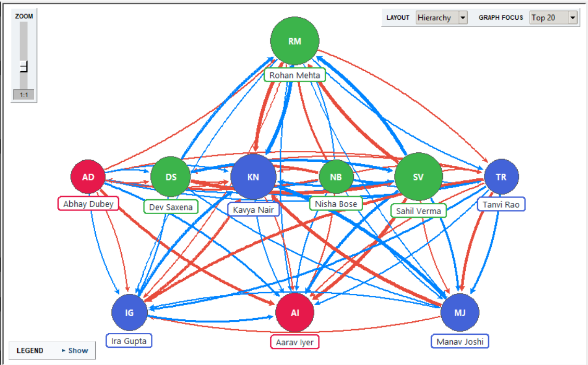
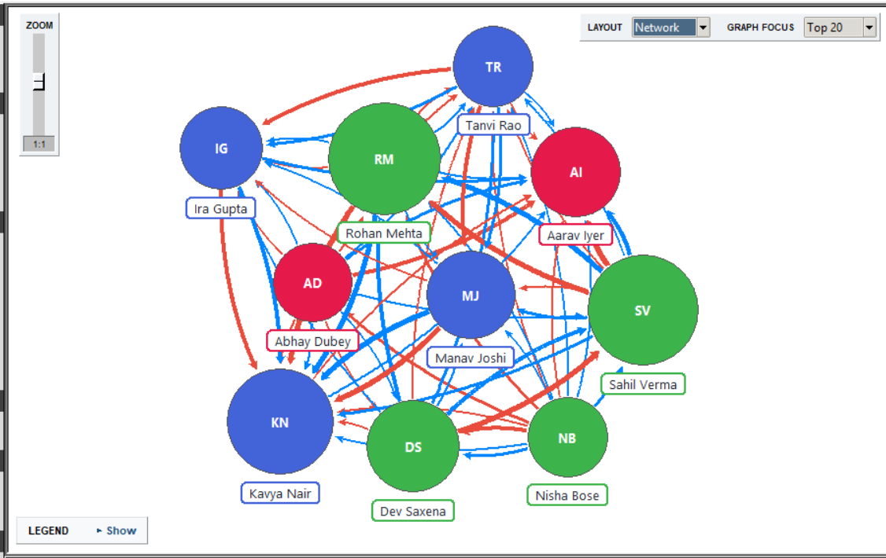
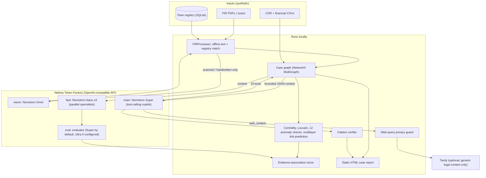

# PSCYPHER: evidence-first criminal-network analysis workbench

> **All data in this repository is synthetic.** Every person, phone number, account, FIR and event is fictional and was generated for demonstration. Scores, anomalies, communities and predicted links are **investigative leads for a human to verify, not evidence of guilt.**

PSCYPHER is a Tkinter + NetworkX desktop workbench that merges FIR documents, call-detail records (CDR) and financial transactions into one case graph, runs network analytics locally, and lets an investigator question the case through a **tool-calling Nemotron copilot** whose every cited file and row is checked against the loaded evidence.

- **Hackathon:** Nebius x NVIDIA Global AI Hackathon, track **Best Apps and Agents**
- **Runs on:** Nebius Token Factory (OpenAI-compatible API, `https://api.tokenfactory.nebius.com/v1/`)
- **NVIDIA models:** `nvidia/nemotron-3-super-120b-a12b` (main: tool-calling copilot; also the evaluator role by default) and `nvidia/NVIDIA-Nemotron-3-Nano-30B-A3B` (fast: parallel specialists). Both were called live on Token Factory in the evaluation run in [`docs/evaluation/`](docs/evaluation/pscypher_evaluation.md). `nvidia/Nemotron-3-Nano-Omni` is the configured vision model for scanned FIRs:. No Ultra model ID was configured.
- **Demo video:** **https://youtu.be/_3itHofAs88**
- **Team:** Abhijeet Kumar (Ideation), Animesh Kumar (Backend), Krish Majhi (LLM Architecture), Saumya Baskar (Mathematical Aspects), Amritash Mishra (Design and frontend), Amritup Vats (Workflow)

**Screenshots** (synthetic demo case: 10 entities, graph focus "Top 20"; the in-app legend, bottom left, explains the colours):

| Hierarchy layout | Network layout |
|---|---|
|  |  |

---

## 1. What it does

1. **Ingest.** A SQLite "town registry" holds fictional citizens. FIR PDFs or scans are transcribed and the people in them are matched to registry citizens (exact unique names can be auto-confirmed in the demo; anything ambiguous goes to a Yes/No prompt). FIRs add *people*, never *links*.
2. **Evidence layers.** CDR and financial CSVs become relationship layers (`Calls`, `Transactions`). Each link keeps the source file and row of every observation.
3. **Local analytics (no tokens spent).** Composite centrality (degree, betweenness, closeness, eigenvector), Louvain communities, a 12-class explainable anomaly engine, multilayer link prediction, and a transparent 0-100 **evidence-association score** (30% network influence, 25% anomalies, 20% relationship strength, 15% FIR mentions, 10% link-prediction signal).
4. **Copilot (Nemotron Super with tools).** The agent queries the live graph instead of guessing, then every answer ends with `TOOLS USED` and a `CITATION CHECK`.
5. **Specialists + evaluator.** "Explain Score" runs three Nemotron Nano specialists concurrently (criminology, temporal, context) and an evaluator model synthesises a short JSON briefing.
6. **Interactive HTML case report.** One self-contained static page (no network, no external scripts) with the graph, tables, saved copilot answers and the evaluation results.

## 2. Setup

**Requirements.** Python 3 with tkinter, a Nebius Token Factory API key, and the packages below.

```bash
git clone <this repository> && cd pscypher-nebius
pip install -r requirements.txt            # core: networkx numpy scikit-learn openai
pip install -r requirements-optional.txt   # optional: pydantic, pillow, pytesseract, thefuzz, neo4j

# PDF reading is needed for the demo FIR PDFs. PyMuPDF is AGPL-3.0, so it is NOT in the requirements files;
# read THIRD_PARTY.md, then install it yourself if you accept its licence:
pip install pymupdf
```

**Configure the key (never commit it).**

```bash
# Linux / macOS
export NEBIUS_API_KEY="..."
# Windows PowerShell
$env:NEBIUS_API_KEY="..."
```

Optional: `TAVILY_API_KEY` (enables the `web_context` tool), and per-role model overrides `NEBIUS_MODEL_FAST`, `NEBIUS_MODEL_MAIN`, `NEBIUS_MODEL_EVAL`, `NEBIUS_MODEL_VISION`. The file also has `NEBIUS_API_KEY_DEFAULT` / `TAVILY_API_KEY_DEFAULT` constants for convenience; **leave them as `""` in anything you commit or share.**

**Run.**

```bash
python Pscypher_nebius.py
```

**Verify your setup first.** Use **Analysis > Run Live Self-Test**. It sends only generic synthetic probes and reports PASS/WARN/FAIL for: key accepted and catalog listing, each configured model ID present in the catalog, a chat completion per text model, JSON mode on the eval model, tool calling on the main model, vision reading a generated image, and tokens/estimated cost. **Analysis > Check Nebius Models & Tool Support** lists the catalog features per model.

**Load the demo case.** The synthetic dataset is in `pscypher_demo_dataset/` next to the script; run the app from the repository root, then **File > Load Demo Case**. It loads the registry, three FIR PDFs, the CDR and financial CSVs, then runs centrality, communities, anomalies and link prediction. The dataset's own documentation lists the expected result as 10 people, 65 distinct relationship edges (29 Calls + 36 Transactions) and 700 observations.

Then **File > Export Interactive HTML Case Report**.

**Files the app writes** (do not commit them): `pscypher_town.sqlite3` and `pscypher_saved_answers.json` beside the script, and `<fir>_transcription.txt` plus `<fir>_fir_cache_*.json` beside each FIR. The cache files contain absolute local paths.

## 3. Architecture



## 4. How Nemotron and Token Factory are used

All model calls go through the standard `openai` client pointed at Token Factory. Work is routed to the smallest model that can do it:

| Role | Default model ID in the code | Used for |
|---|---|---|
| fast | `nvidia/NVIDIA-Nemotron-3-Nano-30B-A3B` | Three parallel specialists |
| main | `nvidia/nemotron-3-super-120b-a12b` | Copilot: tool-calling agent over the graph, FIR text and evidence |
| eval | defaults to the **main** model; set `NEBIUS_MODEL_EVAL` to use Ultra | Synthesises the specialists; model-comparison runs |
| vision | `nvidia/Nemotron-3-Nano-Omni` | Scanned / handwritten FIR transcription and entity extraction |

**IDs run live in the submission (from the evaluation report):** `nvidia/nemotron-3-super-120b-a12b` and `nvidia/NVIDIA-Nemotron-3-Nano-30B-A3B`. With no `NEBIUS_MODEL_EVAL` override the evaluator role is the Super model, so the defaults use three distinct model IDs for four roles. Omni: see the header bullet.

- **Tool-calling copilot.** `run_tool_agent` lets the model call up to 10 tools (`investigation_summary`, `find_entity`, `entity_context`, `anomalies_for_entity`, `evidence_for_entity`, `shortest_path`, `search_fir_text`, `relationship_summary`, `link_prediction_for`, `web_context`) for at most 6 turns, then forces a final answer. If the endpoint rejects `tools`, it falls back to a single-shot answer. `relationship_summary` returns exact totals so the model never estimates a sum.
- **Parallel specialists.** `parallel_specialists` sends three Nano calls at once with a thread pool; one failed specialist does not abort the analysis. The app records wall-clock time against the sum of per-call times and prints it on the `MODEL ROUTING` line.
- **Vision.** For image-only FIRs, an Omni call returns JSON validated against a Pydantic schema. If it fails, the app falls back to local text, then to Tesseract. The demo's three FIRs are digital PDFs and take the offline path, so they do not exercise the vision model.
- **Citation verifier.** Cited CSV filenames and rows are checked against the loaded evidence; cited external URLs are checked against the URLs `web_context` actually returned, and reported separately from case evidence.
- **Cost and token accounting.** Every call's token usage is recorded (Analysis > AI Usage & Cost). The price table in the code is approximate (taken from a third-party gateway listing); confirm against the Token Factory catalog.

**Where Token Factory sped things up.** We have no measurement of a speed-up and make no claim of one. What we did measure (evaluation run of 2026-10-29, see section 6; that run used a graph with duplicated transaction counts, so re-run before quoting it): the Super model answered the six evaluation questions in 31.6 s (2 tool calls, 76,903 tokens, estimated $0.0242) and the Nano model in 140.8 s (4 tool calls, 148,249 tokens, estimated $0.0135); both used Token Factory's OpenAI-compatible tool calling.

## 5. Data-privacy notes

- **Synthetic only.** Do not load real case data into this prototype. It has had no legal, security or data-protection review.
- **What leaves the machine when AI is used:** the question; a bounded JSON summary of the graph (capped at 16,000 characters); up to five FIR excerpts of about 1,800 characters each; and tool results (each truncated to 6,000 characters). Graph analytics, anomaly detection, link prediction and scoring run locally.
- **Digital FIR PDFs are read offline** and matched against the local registry; image-only FIRs are sent to the vision model.
- **Web context is privacy-screened.** Before any Tavily call, `check_web_query` rejects queries containing email addresses, UPI-like ids, IFSC codes, phone-number forms, long digit runs, account numbers, vehicle registrations, identifier-like strings, FIR references, any entity label or id in the graph, or 5+ consecutive words from a FIR, and queries over 200 characters. The block message never echoes the offending text. This is a heuristic filter, not a guarantee.
- **Not evidence.** Web results are labelled `EXTERNAL SOURCE (web), not case evidence` and cited only by exact URL. The system prompt forbids declaring anyone guilty and requires observed facts to be separated from hypotheses.
- **Keys.** Read from environment variables; never written into the HTML report.

## 6. Measured evaluation

Run **Analysis > Run Measured Evaluation (ground truth)** and pick `pscypher_demo_dataset/ground_truth/ground_truth_DEMO_ONLY.csv` (the sibling `ground_truth_links_DEMO_ONLY.csv` is in the same folder). Answering "No" to the LLM prompt gives graph-only metrics at no token cost. The full generated report is in [`docs/evaluation/pscypher_evaluation.md`](docs/evaluation/pscypher_evaluation.md) (JSON alongside).

Ground truth is a planted synthetic dataset (10 people, 3 FIRs); these results show the pipeline works on that structure, not real-world accuracy.

| Experiment | What it measures | Result (run of 2026-10-29) |
|---|---|---|
| E1 | FIR person-extraction precision / recall / F1 vs planted truth | Macro P / R / F1 = 1.00 / 1.00 / 1.00 (FIR-1 5/5, FIR-2 4/4, FIR-3 5/5). The demo FIRs are digital PDFs read offline and matched to unique registry names, so this tests that path, not the vision model |
| E2 | Key-player precision@3 for four measures vs planted core (Kavya Nair, Rohan Mehta, Sahil Verma) | 1.00 for composite centrality, weighted degree, betweenness and the evidence association score; random baseline 0.30 |
| E3 | Cross-case link ranking (FIR-1 people x FIR-2 people, 20 candidate pairs, 2 planted) | precision@2 1.00, MRR 1.00, ROC-AUC 1.00; random baseline 0.10. Rohan Mehta <-> Kavya Nair ranked #1, Sahil Verma <-> Kavya Nair #2 |
| E4 | Link prediction: ROC-AUC / average precision per relation layer (stratified CV) | Transactions 0.63 / 0.69 (7 pos / 7 neg held out); Calls 0.80 / 0.79 (5 / 5) |
| E5 | LLM comparison on six scored questions; hallucinated-citation rate | see table below |

**E5 (single run, low temperature, six questions).**

| Model | Q1 | Q2 | Q3 | Q4 | Q5 | Q6 | mean | tool calls | case citations (not found) | external URLs (not returned by web_context) | time | est. cost |
|---|---|---|---|---|---|---|---|---|---|---|---|---|
| `nvidia/nemotron-3-super-120b-a12b` | 0.00 | 0.00 | 1.00 | 1.00 | 0.00 | 0.25 | **0.38** | 2 | 4 (0) | 2 (2) | 32 s | $0.0242 |
| `nvidia/NVIDIA-Nemotron-3-Nano-30B-A3B` | 0.67 | 0.00 | 0.00 | 1.00 | 1.00 | 0.50 | **0.53** | 4 | 5 (1) | 1 (0) | 141 s | $0.0135 |

Hallucinated case-citation rate: Super 0% (0 of 4), Nano 20% (1 of 5). Totals for the two models: 225,152 tokens, estimated $0.0377 from the app's approximate price table. In this run Nano scored higher than Super on the mean; neither model named BNS s.308 for Q6 (both cited Indian Penal Code sections).

## 7. Limitations

- **Synthetic, tiny, planted.** Ground truth is a 10-person synthetic dataset with planted structure. Results show the pipeline works on that structure, not real-world accuracy.
- **Single runs.** Evaluation scores come from single low-temperature runs; small differences between models are not significant.
- **Heuristic scoring.** Q4 (missing-source refusal) uses a keyword heuristic; Q1-Q3 and Q5 are exact-match style. The anomaly engine and the evidence-association weights are transparent heuristics, not calibrated models.
- **Small-graph ML.** Link prediction needs at least 4 relationships and, on small graphs, metrics are noisy.
- **Identity resolution is name-based.** Common names need human review. Exact-unique-name auto-confirm is a demo shortcut for datasets with known-unique names.
- **Offline FIR path is registry-bound.** For digital PDFs it finds only names that exist in the registry; other entities require the cloud/OCR path.
- **API assumptions not guaranteed.** Tool calling, JSON mode and image input depend on the endpoint and model. The self-test checks them; the catalog feature field names the app reads (`supported_features` / `features` / `capabilities`) are not guaranteed by the API. 
- **Perfect scores on E1-E3 are weak evidence.** E1 tests offline matching of unique names, E2 and E3 are easy on a 10-node planted graph (random baselines 0.30 and 0.10). They show the planted structure is recovered, nothing more.
- **E4 is noisy.** Only 5-7 held-out positives per layer; the Transactions ROC-AUC of 0.63 is close to chance.
- **E5 is one run of six questions.** Super scored 0.00 on Q1, Q2 and Q5 and Nano scored higher on the mean (0.53 vs 0.38); Super's two external URLs were not returned by the search tool and Nano had one case citation not found. These differences are not statistically meaningful, and the run used a graph with doubled transaction counts (see section 6).
- **Cost figures are estimates** from an approximate price table.
- **Desktop prototype.** A single-file Tkinter app, not a hosted service. The shareable demo is the static HTML report.
- **Not forensic software.** Not validated for investigative or legal use.

## 8. Licence and third-party software

Project licence: **Apache-2.0** (see [`LICENSE`](LICENSE)). The demo dataset is synthetic and released under the same licence. Third-party packages and services, including the PyMuPDF (AGPL-3.0) note, are listed in [`THIRD_PARTY.md`](THIRD_PARTY.md).

## 9. Repository layout

```
pscypher-nebius/
|-- Pscypher_nebius.py            the whole application (single file)
|-- README.md
|-- LICENSE                       Apache-2.0
|-- THIRD_PARTY.md                third-party licences, PyMuPDF (AGPL) note
|-- requirements.txt              core dependencies
|-- requirements-optional.txt     optional dependencies
|-- .gitignore
|-- pscypher_demo_dataset/        synthetic demo data (must stay beside the script; the app looks for this folder name)
|   |-- README_DEMO.txt
|   |-- town_10000_citizens.csv
|   |-- town_relationships.csv
|   |-- cdr_500_demo.csv
|   |-- financial_200_demo.csv
|   |-- FIR_01_SYNTHETIC_EXTORTION.pdf
|   |-- FIR_02_SYNTHETIC_INVESTMENT_FRAUD.pdf
|   |-- FIR_03_SYNTHETIC_CARGO_THEFT.pdf
|   `-- ground_truth/             planted ground truth, used only by the measured evaluation
|-- docs/
|   |-- screenshots/              graph_hierarchy.png, graph_network.png
|   `-- evaluation/               pscypher_evaluation.md and .json (generated by the app)
```
